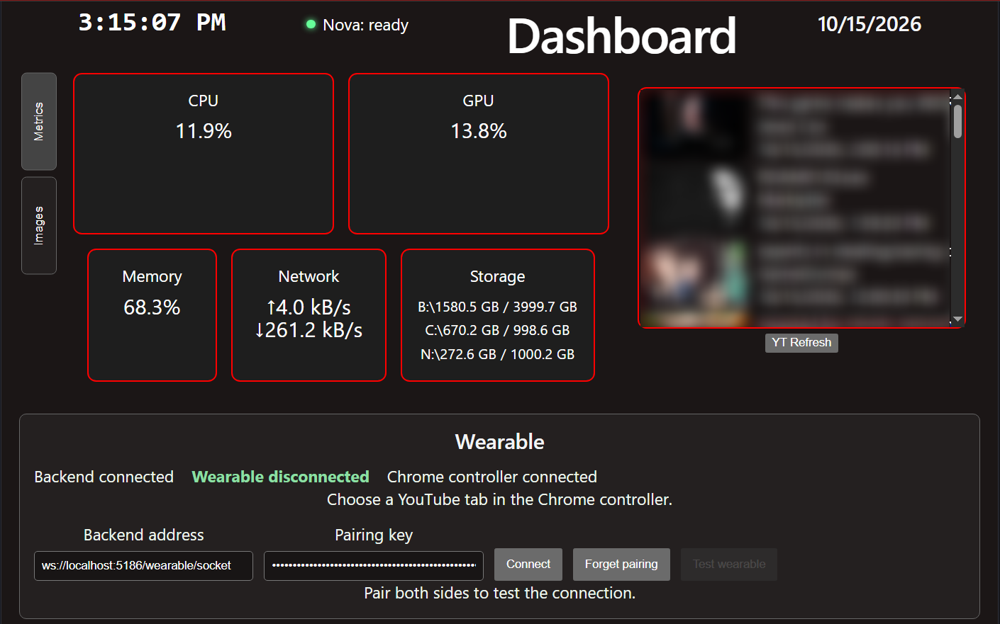

# DashboardAppV2

A modular local desktop dashboard that combines real-time PC monitoring, media integrations, local services, and wearable-device control into a single interface.

> Built as a personal daily-use control hub rather than a standalone demo application.



## Overview

DashboardAppV2 is a full-stack desktop dashboard built to act as the central interface for a larger local computing environment.

The project combines a React and TypeScript frontend with an ASP.NET Core backend. The backend collects live system telemetry, manages external API integrations, exposes local services, and coordinates communication between the PC dashboard, a Raspberry Pi wearable computer, and a Chrome-based media controller.

The dashboard is used as an always-available control surface rather than a traditional web application. It runs locally and brings together information and controls that would otherwise be spread across separate tools.

## Features

### Real-Time System Monitoring

Live PC telemetry is collected by the backend and streamed to the dashboard through SignalR.

Current metrics include:

- CPU usage
- GPU usage
- Memory utilization
- Network upload and download activity
- Storage usage across multiple drives

Metrics update continuously without requiring page refreshes.

### Media and YouTube Integration

The backend connects to the YouTube API using OAuth and maintains a local cache of subscription uploads.

The dashboard can:

- Display recent subscription uploads
- Manually refresh YouTube data
- Provide YouTube browsing data to the wearable
- Coordinate playback with a selected Chrome tab
- Track current playback state
- Control playback, seeking, volume, and fullscreen state remotely

OAuth credentials and tokens remain local and are excluded from the repository.

### Raspberry Pi Wearable Integration

DashboardAppV2 also serves as the PC-side hub for a separate Raspberry Pi wearable computer.

A dedicated WebSocket service allows the wearable to communicate with the dashboard backend independently of the main SignalR connection.

The integration supports:

- Secure local pairing using a generated key
- Automatic reconnection
- Connection-status reporting
- Two-way test and acknowledgement messages
- YouTube browsing requests
- Remote playback controls
- Playback-state synchronization
- Local speech-transcription requests

The wearable connection is intended for use on a trusted local network.

### Chrome Playback Controller

A companion Chrome extension connects to the backend and controls one selected YouTube tab.

This allows the Raspberry Pi wearable to interact with normal YouTube playback running on the PC without embedding a separate player.

The controller supports:

- Selecting a YouTube tab
- Opening requested videos and playlists
- Play and pause
- Next-video control
- Seeking
- Volume adjustment
- Fullscreen control
- Live playback-state reporting

The extension requests access only to YouTube and the browser capabilities required for playback control.

### Image Slideshow

The dashboard includes a local image slideshow with a separate upload interface.

Images can be added remotely through a browser using a PIN-protected upload page.

The slideshow directory and upload PIN are configured locally rather than stored in the public repository.

### Local Service Status

The dashboard can display the status of other locally running services through lightweight local API integrations.

This allows independent applications to expose health or state information to the main dashboard without being tightly coupled to its frontend.

## Architecture

```text
                         ┌─────────────────────────┐
                         │    React Dashboard      │
                         │   TypeScript + Vite     │
                         └────────────┬────────────┘
                                      │
                              HTTP / SignalR
                                      │
                         ┌────────────▼────────────┐
                         │   ASP.NET Core Backend  │
                         └────────────┬────────────┘
                                      │
          ┌───────────────────────────┼───────────────────────────┐
          │                           │                           │
          ▼                           ▼                           ▼
 ┌─────────────────┐       ┌──────────────────┐        ┌──────────────────┐
 │ System Telemetry│       │ Local Services   │        │ External APIs    │
 │ CPU / GPU / RAM │       │ Slideshow        │        │ YouTube / OAuth  │
 │ Network / Drives│       │ Service status   │        │                  │
 └─────────────────┘       └──────────────────┘        └──────────────────┘
                                      │
                                      │ WebSocket
                                      ▼
                         ┌─────────────────────────┐
                         │ Wearable Coordination   │
                         └────────────┬────────────┘
                                      │
                     ┌────────────────┴────────────────┐
                     │                                 │
                     ▼                                 ▼
          ┌────────────────────┐            ┌────────────────────┐
          │ Raspberry Pi       │            │ Chrome Extension   │
          │ Wearable Computer  │            │ YouTube Controller │
          └────────────────────┘            └────────────────────┘
```

## Technology Stack

### Frontend

- React
- TypeScript
- Vite
- SignalR client
- CSS

### Backend

- ASP.NET Core
- C#
- SignalR
- Native WebSockets
- Google OAuth 2.0
- YouTube Data API
- Windows system-performance APIs

### Companion Systems

- Raspberry Pi wearable client
- Chrome extension
- Local HTTP services
- Local speech-transcription service

## Project Structure

```text
DashboardAppV2/
├── backend/
│   ├── Program.cs
│   ├── hubs/
│   ├── models/
│   ├── services/
│   └── wearable/
│       ├── models/
│       ├── services/
│       └── speech/
│
├── frontend/
│   └── src/
│       ├── components/
│       ├── models/
│       ├── services/
│       └── wearable/
│
└── wearable/
    └── chrome-extension/
```

### `backend/`

ASP.NET Core application responsible for:

- System telemetry
- SignalR broadcasting
- YouTube authentication and API access
- Slideshow hosting and uploads
- Local service integration
- Wearable WebSocket communication
- Playback coordination
- Speech requests

### `frontend/`

React interface containing the primary dashboard UI, including:

- System metrics
- Network and storage displays
- Clock and calendar
- Image slideshow
- YouTube uploads
- Local-service status
- Wearable connection controls

### `wearable/chrome-extension/`

Companion Chrome extension used to bridge backend commands to an active YouTube tab.

## Security and Local Configuration

The repository intentionally excludes machine-specific credentials and configuration.

Examples include:

- OAuth client credentials
- OAuth access and refresh tokens
- Wearable pairing keys
- Development-specific application settings
- Local filesystem paths
- Local slideshow configuration
- Environment files

The wearable pairing key is generated locally and stored outside version control.

The wearable WebSocket service is designed for trusted local-network use and is not intended to be exposed directly to the public internet.

## Development Notes

This project evolved from a personal system-monitoring dashboard into a broader local integration hub.

Instead of building each feature as an isolated tool, the dashboard became a shared coordination layer between:

- The Windows desktop
- Local background services
- External APIs
- A Raspberry Pi wearable computer
- Browser-based media controls

This architecture allows new local tools and devices to integrate with a single backend rather than each requiring their own independent interface.

## Current Status

**Active daily-use project**

The dashboard is currently used as a personal PC hub and continues to evolve as new devices and local services are added.

Core features currently in use include:

- Real-time system monitoring
- YouTube subscription integration
- Image slideshow and uploads
- Local service status
- Wearable connectivity
- Chrome playback control
- Speech-processing support

## Related Project

The wearable integration is designed to work with the separate Raspberry Pi wearable-computer project:

[WearableIoTDevice](https://github.com/totoan/WearableIoTDevice)

## License

This project is licensed under the terms included in the repository's `LICENSE` file.